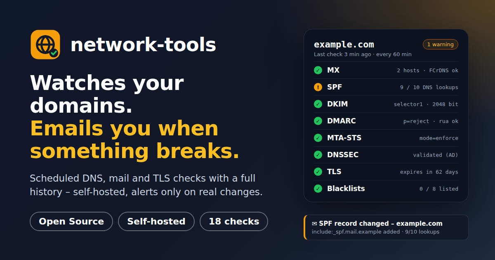

# network-tools
### The self-hosted domain monitor for DNS, mail and TLS

---

network-tools (the app is called **Domain-Monitor**) watches your domains around the clock: MX, SPF, DKIM, DMARC, MTA-STS, TLS-RPT, BIMI, DNSSEC, TLS certificates, domain expiry and blacklists. It keeps a history of every check and emails you when something breaks or changes, such as a new SPF record, an expiring certificate or a blacklist listing. It runs on your own server, logs in with passkeys and has no passwords.

## Installation & quick start

network-tools ships as a ready-made Docker image (`ghcr.io/roberteinsle/network-tools`) with a PostgreSQL database. A small server, a domain for the backend and an SMTP mailbox for alerts are all you need.

1. In **Coolify**, create a **PostgreSQL** database and enable backups.
2. Create a *Docker Compose (Empty)* resource with [`deploy/docker-compose.coolify.yml`](deploy/docker-compose.coolify.yml) and set `APP_KEY`, `APP_URL` and the `DB_*` variables ([Configuration](https://github.com/roberteinsle/network-tools/wiki/Configuration)).
3. Add your domain with port `8080` to the `app` service and deploy.
4. In the container terminal, run `php artisan app:user you@example.com`. It prints a login link right away.
5. Register a passkey, enter your SMTP server under *Settings* and add your domains.

The **[installation guide in the wiki](https://github.com/roberteinsle/network-tools/wiki/Installation)** covers every step, updates and local development.

## How it works

A scheduler queues due domains every five minutes, and a worker runs all enabled checks. Each run is stored with its full results and compared with the previous one.

- **Alerts on real changes only:** a mail goes out when a check gets worse, is fixed or its records change. Timeouts and resolver hiccups never trigger an alert.
- **Built for many domains:** group domains by customer, inherit DKIM providers, and send alerts to global, customer and domain recipients.
- **Everything in the backend:** SMTP, recipients, thresholds, intervals, resolvers and the Spamhaus DQS key are configured in the UI. Secrets are stored encrypted.

## Checks

| Check | What it covers |
|---|---|
| [MX](https://github.com/roberteinsle/network-tools/wiki/Checks#mx) | Records, null MX, A/AAAA of MX hosts, CNAME and IP mistakes |
| [A / AAAA](https://github.com/roberteinsle/network-tools/wiki/Checks#a--aaaa) | Domain and `www.` (or your own web hosts), private addresses |
| [PTR](https://github.com/roberteinsle/network-tools/wiki/Checks#ptr-reverse-dns) | Reverse DNS of MX and outgoing IPs, including FCrDNS |
| [SPF](https://github.com/roberteinsle/network-tools/wiki/Checks#spf) | Syntax, duplicates, `all` qualifier, recursive **10-lookup counter** and void lookups |
| [DKIM](https://github.com/roberteinsle/network-tools/wiki/Checks#dkim) | Known selectors per provider (Microsoft 365, Google, Mailchimp, SendGrid …), custom selectors, key length |
| [DMARC](https://github.com/roberteinsle/network-tools/wiki/Checks#dmarc) | Policy, `pct`, `sp`, `rua` including authorization of external report receivers |
| [MTA-STS](https://github.com/roberteinsle/network-tools/wiki/Checks#mta-sts) | TXT record, policy over HTTPS, mode, match with the MX hosts |
| [TLS-RPT](https://github.com/roberteinsle/network-tools/wiki/Checks#tls-rpt) | Record and report targets |
| [BIMI](https://github.com/roberteinsle/network-tools/wiki/Checks#bimi) | Record, SVG Tiny PS logo, DMARC requirement, VMC |
| [DNSSEC](https://github.com/roberteinsle/network-tools/wiki/Checks#dnssec) | DS at the registrar, DNSKEY, validation via the AD flag |
| [TLS certificates](https://github.com/roberteinsle/network-tools/wiki/Checks#tls-certificate-https) | HTTPS (domain, www, mta-sts) and optional MX STARTTLS on port 25: trust, host name, expiry |
| [Domain expiry](https://github.com/roberteinsle/network-tools/wiki/Checks#domain-expiry) | RDAP via IANA bootstrap |
| [Blacklists](https://github.com/roberteinsle/network-tools/wiki/Checks#blacklists) | A small set of free RBLs; **Spamhaus only via DQS** with your own key |

Everything else – every field, setting and alert rule – is in the **[wiki](https://github.com/roberteinsle/network-tools/wiki)**.

## Privacy & security

network-tools runs on your server and only contacts the resolvers, registries, blacklists and hosts the checks need. There is no telemetry. The SMTP password and the DQS key are encrypted with `APP_KEY`. Login works with passkeys or a one-time magic link; there are no passwords.

Please report vulnerabilities privately via [GitHub security advisories](https://github.com/roberteinsle/network-tools/security/advisories/new).

## Contributing

Ideas, feature requests and bug reports are welcome as [issues](https://github.com/roberteinsle/network-tools/issues).

**For developers:** PHP 8.5, Laravel 13, Filament 5, PostgreSQL, tests with PHPUnit. The repository opens ready to use in the dev container or GitHub Codespaces; `php artisan test` runs the tests. Architecture notes are in [CLAUDE.md](CLAUDE.md), and the full documentation is in the [handbook](handbuch/), from which the wiki is generated.

## Links

- **Website:** [network-tools.einsle.app](https://network-tools.einsle.app)
- **Wiki:** [Documentation and installation guide](https://github.com/roberteinsle/network-tools/wiki)
- **Versions:** [Releases](https://github.com/roberteinsle/network-tools/releases)
